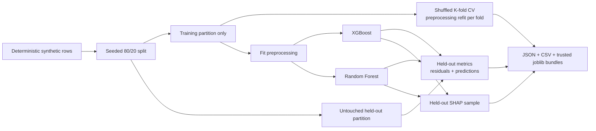

# Model Evaluation Workbench

[](https://github.com/cjf-iii/model-evaluation-workbench/actions/workflows/tests.yml)


A reproducible, leakage-aware comparison of XGBoost and Random Forest with held-out testing, cross-validation, residual analysis, persisted model bundles, and SHAP explainability.

> Resume claim: Trained and evaluated XGBoost and Random Forest models using held-out tests, cross-validation, error analysis, and SHAP explainability.

## Review it

```bash
uv sync --locked
uv run python -m unittest discover -s tests -v
uv run model-eval --rows 500 --estimators 50 --cv-folds 3 --output artifacts
uv run python scripts/verify_artifacts.py
```

The project uses `uv` exclusively. `.python-version` pins Python 3.12 and `uv.lock` pins the complete environment.

## Executable reviewer notebook

[Open the raw-data-to-validation tutorial](notebooks/01_data_to_validation.ipynb), or launch it from the repository root:

```bash
uv sync --locked --group notebook
uv run --group notebook jupyter lab notebooks/01_data_to_validation.ipynb
```

The notebook introduces spreadsheet-style defects into 500 generated rows, proves exact recovery of the canonical data, then executes the real held-out/CV/SHAP workflow and test suite. CI executes every cell without modifying the committed notebook.

## Evaluation design



The held-out rows remain outside model fitting and cross-validation. Each cross-validation fold owns its preprocessing pipeline, preventing information from the validation fold from influencing scaling or category encoding.

## Evidence from one run

```text
artifacts/
├── synthetic_deals.csv
├── evaluation_report.json
├── held_out_predictions.csv
├── xgboost_bundle.joblib
├── random_forest_bundle.joblib
├── xgboost_shap_importance.csv
└── random_forest_shap_importance.csv
```

The report preserves split sizes, seed, fold count, held-out R-squared/MAE/RMSE/MAPE, cross-validation MAE distribution, and residual quantiles. The prediction CSV retains every held-out truth, prediction, and residual. The verifier reloads both bundles and scores a row.

## Synthetic inputs

- annual spend and audience reach;
- activation-channel count and contract term;
- renewal probability;
- deal type, market scope, and industry vertical;
- synthetic commercial-value target created from documented nonlinear relationships plus noise.

No row represents a real customer or transaction. Scores measure recovery of the generator’s synthetic relationships, not expected performance on business data.

## CLI

```text
--rows         Number of generated rows, minimum 100 (default: 1500)
--seed         Generator, split, fold, and estimator seed (default: 42)
--estimators   Trees per model (default: 160)
--cv-folds     Training-partition folds (default: 4)
--output       Evidence directory (default: artifacts)
--skip-shap    Omit SHAP for a faster exploratory run
```

Fast exploratory check:

```bash
uv run model-eval --rows 300 --estimators 30 --cv-folds 2 --skip-shap --output artifacts
```

## Repository map

```text
.
├── .github/workflows/tests.yml  # public Ubuntu release gate
├── notebooks/01_data_to_validation.ipynb
├── scripts/verify_artifacts.py
├── src/model_evaluation_workbench/
│   ├── cli.py
│   ├── data.py                  # deterministic synthetic generator
│   └── evaluation.py            # split, CV, errors, SHAP, persistence
├── tests/
├── MODEL_CARD.md
├── pyproject.toml
└── uv.lock
```

## Evidence and boundaries

- SHAP attributes fitted model behavior; it does not establish causality.
- The workflow evaluates one fixed configuration per estimator. It does not describe these results as hyperparameter optimization.
- The workbench establishes evaluation correctness and repeatability, not production latency, drift handling, or deployment readiness.
- Joblib artifacts use pickle-compatible serialization. Load only files created locally or obtained from a trusted source.
- The public workflow installs from `uv.lock`, checks Ruff, runs unit/integration tests, performs a 500-row evaluation with SHAP, validates the data split and outputs, and reloads both model bundles.

See [MODEL_CARD.md](MODEL_CARD.md) for intended use and limitations and [VERIFICATION.md](VERIFICATION.md) for the recorded release evidence.

## Local pre-push gate

GitHub Actions is authoritative. To run the same locked lint and test checks before a local push:

```bash
git config core.hooksPath .githooks
```

The committed hook invokes only `uv sync --locked` and `uv run`; it does not use a system Python environment.

## License

[MIT](LICENSE)
